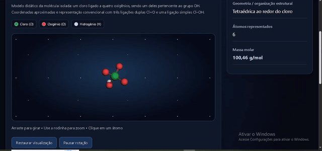
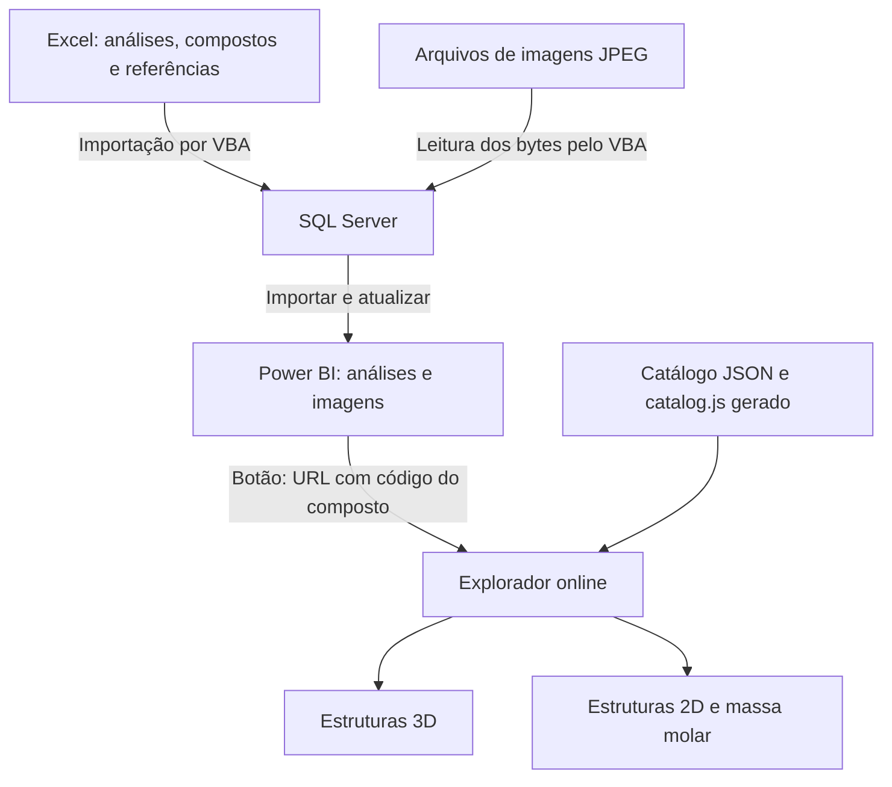
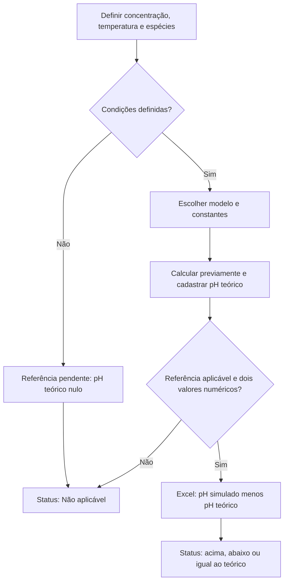

# Explorador Molecular CFA — Chemical for All

**Versão de testes: v0.2.2 — projeto em desenvolvimento.**

Projeto de portfólio de **Kelvin Gonçalves Bruno**, estudante de Engenharia Química, que integra Excel/VBA, SQL Server, Power BI e um explorador de estruturas químicas em 2D e 3D.

[**Abrir o explorador online**](https://explorador-molecular-cfa.smokycamel65.chatgpt.site) · [Exemplo: amônia](https://explorador-molecular-cfa.smokycamel65.chatgpt.site/?composto=NH3)

O site é público e pode ser acessado sem conta no ChatGPT. O relatório Power BI contém um botão que abre o explorador com o composto selecionado.



## O que o projeto demonstra

- Registro de análises e referências de pH no Excel, com fórmulas e imagens de compostos.
- Importação por VBA/ADO para SQL Server, com validação, transação, comparação entre fonte e destino e inativação de registros ausentes.
- Modelagem e visualização no Power BI, integradas ao explorador por uma medida DAX.
- Catálogo de 17 compostos em JSON e visualização em HTML, CSS, JavaScript e 3Dmol.

O fluxo de dados é **Excel → SQL Server → Power BI**. O botão do relatório abre o **explorador online**. O site usa seu catálogo versionado; não consulta o SQL Server de quem está visualizando.

## Visão geral da arquitetura



O botão envia o código do composto na URL. O explorador usa o catálogo versionado para mostrar a estrutura; alterações nas análises do SQL aparecem no Power BI após a atualização do relatório. Alterações no catálogo do site precisam ser geradas e publicadas.

## Visualizar o projeto

### Pelo navegador

Abra o [explorador online](https://explorador-molecular-cfa.smokycamel65.chatgpt.site). Não é necessário instalar Excel, SQL Server ou Power BI para visitar o site. O painel 3D depende de WebGL e do carregamento da biblioteca 3Dmol pela internet.

### Pelo Power BI

1. Baixe o projeto e abra [powerbi/LAB_BI_CFA.pbix](powerbi/LAB_BI_CFA.pbix) no Power BI Desktop.
2. Visualize os dados já salvos no relatório. A conexão com o banco do autor não está disponível no seu computador; configure seu ambiente antes de usar **Atualizar**.
3. Selecione um composto e use **Ctrl + clique** no botão do explorador, no Desktop.
4. O navegador abrirá o site com esse composto selecionado. Esse acesso exige internet, mas não exige Live Server nem conta no ChatGPT.

A configuração do endereço está na tabela `ConfigExplorador`, coluna `WebBaseURL`. A medida existente `LinkExplorador` acrescenta `?composto=` e o código selecionado. Não é preciso criar outra medida.

## Reproduzir o fluxo completo

Para importar novas análises e atualizar o relatório, configure seu próprio ambiente Windows com Excel desktop, SQL Server e o driver OLE DB. Siga [docs/SETUP.md](docs/SETUP.md).

A planilha [excel/Lab_EXCELCFA.xlsm](excel/Lab_EXCELCFA.xlsm) já contém os cinco módulos VBA. Não há uma etapa de reinstalação de macros para usar este arquivo. Ajuste servidor, banco e caminho das imagens na aba `Config` antes de importar.

O [SQL enviado pelo autor](sql/consultas/SQLQuery1Lab.sql) é uma consulta auxiliar. As migrações completas estão em [sql/migrations](sql/migrations), com entrada SQLCMD em [sql/Modelagem_Dados_SQL.sql](sql/Modelagem_Dados_SQL.sql). O pacote não contém um backup `.bak` do banco: os dados vêm da planilha.

## Arquivos principais

| Arquivo ou pasta | Conteúdo |
| --- | --- |
| `powerbi/LAB_BI_CFA.pbix` | Relatório atual enviado pelo autor após testar o link online. |
| `excel/Lab_EXCELCFA.xlsm` | Planilha atual com macros incorporadas. |
| `sql/migrations/` | Estrutura e procedimentos de importação, versões 1 a 3. |
| `sql/consultas/SQLQuery1Lab.sql` | Script auxiliar enviado pelo autor. |
| `vba/` | Código das macros; cópias importáveis em `windows-1252/`. |
| `data/compounds.json` | Catálogo canônico dos 17 compostos. |
| `assets/images/` | JPEGs originais usados na importação. |
| `index.html`, `style.css`, `*.js` | Fonte do explorador para execução local. |
| `docs/` | Instalação, arquitetura, contrato de importação e verificação. |

## Executar o explorador localmente

Opcional para desenvolvimento. Na raiz do projeto, com Node.js 20 ou superior:

```sh
npm run check
npm test
npm run serve
```

Abra `http://localhost:5500/index.html`. O endereço público já configurado no relatório funciona independentemente desse servidor local.

## Validação e limites

O autor confirmou a importação no Excel, os testes SQL com rollback e a abertura do explorador a partir do Power BI, incluindo o endereço público. Os arquivos PBIX e XLSM desta distribuição foram preservados byte a byte. Confira [docs/TESTING.md](docs/TESTING.md) para o alcance das verificações.

Os dados são **simulados para fins educacionais**. As estruturas têm coordenadas aproximadas e revisão química independente pendente. Referências e hipóteses de pH estão em [docs/CHEMISTRY_ASSUMPTIONS.md](docs/CHEMISTRY_ASSUMPTIONS.md). Valores pendentes não representam medições realizadas.

## Como as referências de pH entram no projeto

Os valores de pH teórico foram calculados previamente, com apoio de IA, e cadastrados na aba `ReferênciaPH` do Excel. As equações abaixo documentam a origem desses valores; o explorador não executa esses cálculos. O Excel busca a referência cadastrada e calcula a diferença em relação ao pH simulado quando os dois valores são numéricos e a referência é aplicável.

O diagrama representa o processo de definição e uso da referência, não uma rotina que escolhe automaticamente o modelo químico:



## Autor e créditos

**Kelvin Gonçalves Bruno** — Engenharia Química. Projeto pessoal de integração entre química e análise de dados. IA foi usada como apoio na implementação e revisão. A visualização 3D utiliza a biblioteca [3Dmol](https://3dmol.org/).

A licença do projeto ainda depende de escolha do autor; as dependências mantêm suas próprias licenças.

Para disponibilizar os arquivos no seu portfólio, siga [Publicar no GitHub](docs/PUBLICAR_NO_GITHUB.md).
