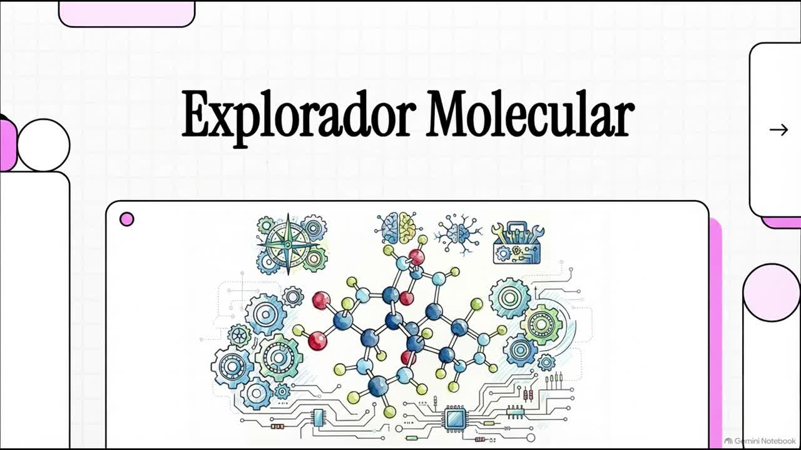
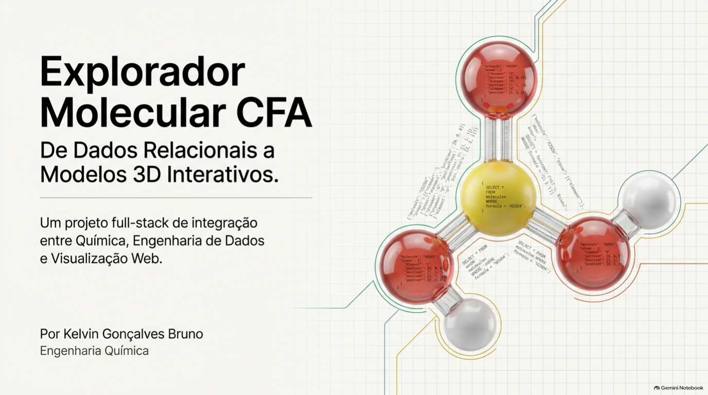
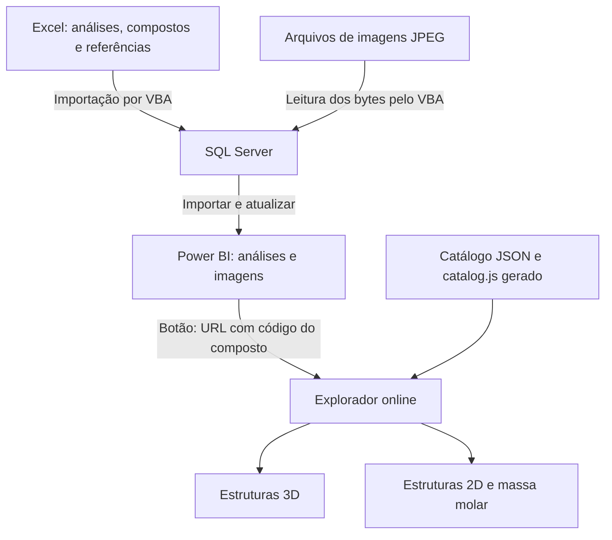
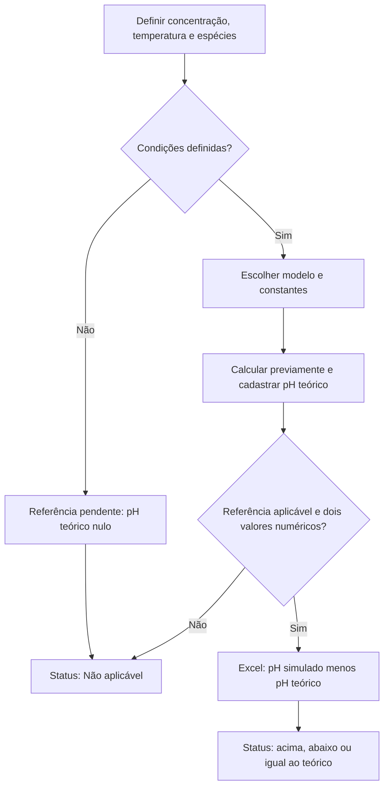

# Explorador Molecular CFA — Chemical for All

**Versão de testes: v0.2.2 — projeto em desenvolvimento.**

Projeto de portfólio de **Kelvin Gonçalves Bruno**, estudante de Engenharia Química.

[**Abrir o explorador online**](https://explorador-molecular-cfa.smokycamel65.chatgpt.site) · [Exemplo: amônia](https://explorador-molecular-cfa.smokycamel65.chatgpt.site/?composto=NH3)

O site é público e pode ser acessado sem conta no ChatGPT. O relatório Power BI contém um botão que abre o explorador com o composto selecionado.

<!-- cfa-video -->
## Conheça o projeto em vídeo

[**Abrir ou baixar o vídeo (MP4 · 6 min 12 s)**](https://github.com/Kelvingb1/Explorador-Molecular/raw/refs/heads/main/assets/videos/Explorador_Molecular.mp4)

Uma visão geral da integração entre Excel/VBA, SQL Server, Power BI e o explorador molecular.
<!-- /cfa-video -->

<!-- cfa-visao-geral -->
## Visão geral em PDF

[**Ler a visão geral do projeto (PDF)**](docs/apresentacoes/Explorador_Molecular_CFA.pdf)

Conheça a arquitetura, a integração entre as ferramentas e os limites dos exemplos químicos em 15 páginas.
<!-- /cfa-visao-geral -->

Este é um projeto que criei para conectar quatro coisas que eu queria aprender ao mesmo tempo: modelagem de dados relacionais, automação com VBA, análise em Power BI e front-end interativo com renderização 3D. Em vez de fazer quatro exercícios separados, decidi fazer um projeto só onde o mesmo dado atravessa as quatro ferramentas — um cadastro de compostos químicos e análises simuladas que nasce no Excel, passa pelo SQL Server, vira relatório no Power BI e termina como um explorador molecular interativo no navegador.

**Os dados de pH medido são simulados, para fins de estudo — não são medições de laboratório.** Os modelos moleculares são didáticos, e a revisão química completa ainda está em andamento.

## Por que fiz o projeto assim

Eu podia ter escolhido uma ferramenta só e um problema fechado. Preferi o contrário: pegar um mesmo conjunto de dados — 17 compostos, suas referências de pH e as análises simuladas — e fazer ele passar por quatro ferramentas diferentes, cada uma responsável por uma etapa:

1. **Excel** é onde cadastro e edito os dados — é a interface mais simples que eu tinha à mão.
2. **SQL Server** é onde o dado ganha integridade de verdade — chaves, relacionamentos, tipos.
3. **Power BI** é onde o dado vira informação — filtros, comparações, apresentação visual.
4. **O explorador web** é onde o dado ganha uma representação que nenhuma das outras ferramentas me dava de graça — um modelo 3D manipulável, no navegador.

A maior parte do que aprendi não foi em nenhuma ferramenta isolada — foi nas costuras entre elas. Foi aí que apareceram os problemas mais interessantes de resolver.

## O que o projeto demonstra

- Organização de compostos, referências de pH e análises simuladas no Excel.
- Automação por VBA/ADO e importação transacional para SQL Server.
- Modelagem relacional com chaves, tipos e integridade entre referência e composto.
- Análise e apresentação dos dados no Power BI, com imagens e navegação por composto.
- Visualização de estruturas químicas em 2D e 3D no navegador.
- Cadastro central, validação de dados, testes automatizados e documentação das limitações.

## Visão geral da arquitetura

O botão envia o código do composto na URL. O explorador usa o catálogo versionado para mostrar a estrutura; alterações nas análises do SQL aparecem no Power BI após a atualização do relatório. Alterações no catálogo do site precisam ser geradas e publicadas.

O Excel organiza as análises e suas referências. O VBA envia os dados e os bytes das imagens ao SQL Server. O Power BI importa os registros ativos e apresenta os resultados. O botão envia o código do composto na URL, por exemplo `?composto=H2SO4`.

Essa ligação com o explorador é de navegação: a URL identifica o composto, mas não envia os valores da análise. O site usa um catálogo versionado e não consulta o banco SQL local de quem está visualizando. Essa escolha permite disponibilizar o explorador publicamente sem expor a instância do banco.

| Componente | Tecnologia | Função e origem dos dados |
| --- | --- | --- |
| Entrada | Excel e VBA | Análises e referências em `excel/Lab_EXCELCFA.xlsm`. |
| Cadastro canônico | JSON | Identificadores, códigos, estruturas, massas e proveniência em `data/compounds.json`. |
| Banco | SQL Server | Projeção reconciliada dos dados, com integridade e registro das importações. |
| Relatório | Power BI e Power Query | Dados importados do SQL e armazenados em `powerbi/LAB_BI_CFA.pbix`. |
| Explorador | HTML, CSS e JavaScript | Seleção, informações e navegação a partir do catálogo gerado. |
| Estruturas 3D | 3Dmol.js | Renderização de SDF com átomos, cargas e ligações explícitas. |
| Estruturas 2D | SVG e JavaScript | Desenhos derivados do mesmo grafo utilizado no modelo 3D. |

## Quem controla cada dado

Na versão inicial, eu mantinha informações do mesmo composto em vários arquivos. A revisão centralizou esse cadastro para reduzir o risco de atualizar um lugar e esquecer outro.

- **JSON:** controla o cadastro dos compostos e os metadados dos elementos. Dele são derivados `catalog.js`, `data/Compostos.csv` e o módulo VBA do catálogo.
- **Excel:** controla as análises e as referências de pH. Seu cadastro de compostos deve corresponder ao catálogo oficial.
- **SQL:** recebe a projeção reconciliada da planilha. Edições diretas no banco podem ser substituídas na próxima importação.
- **Power BI:** importa os dados do SQL após a atualização.
- **Site:** apresenta o catálogo publicado; mudanças nele exigem gerar e publicar a versão atualizada.

Não há sincronização bidirecional entre essas ferramentas. Essa regra torna explícito onde cada alteração deve começar. O contrato está em [docs/ARCHITECTURE.md](docs/ARCHITECTURE.md).

## Organização dos dados

| Aba do Excel | Tabela SQL | Chave principal |
| --- | --- | --- |
| Compostos | `excel.Compostos` | `IDComposto` |
| ReferênciaPH | `excel.ReferenciaPH` | `IDReferencia` |
| Analises | `excel.Analises` | `IDAnalise` |
| Config | Configuração da planilha | `Chave` e `Valor`. |

`excel` é o esquema das tabelas de dados dentro do banco. O ambiente usado para validar a revisão foi `ExploradorMolecularTest`. A tabela antiga `dbo.Analises` foi preservada; qualquer remoção depende de investigar seus consumidores.

As referências pertencem aos compostos: `ReferenciaPH.IDComposto` aponta para `Compostos.IDComposto`. As análises usam uma chave estrangeira composta: `(IDReferencia, IDComposto)` aponta para o mesmo par em `ReferenciaPH`. Assim, uma referência de outro composto é rejeitada pelo banco.

Os registros recebem `Ativo`. Quando uma linha deixa de fazer parte da fonte, a importação a inativa. As views `CompostosAtivos`, `ReferenciaPHAtivas` e `AnalisesAtivas` selecionam os registros usados nas consultas do relatório.

Campos como pH teórico, diferença e status em uma análise representam os valores importados para aquela linha. Essa semântica está documentada; não equivale a um histórico imutável de todas as revisões de uma análise.

## A macro VBA de importação

Essa foi uma das partes mais trabalhosas do projeto. Além de enviar linhas para o banco, precisei lidar com IDs, referências, imagens, números decimais e erros de conexão. A revisão manteve a transação e acrescentou a conferência entre fonte e destino.

A rotina principal está em [vba/modImportacaoSQL.bas](vba/modImportacaoSQL.bas), com o nome `ImportarLaboratorioSQL`:

1. **Recalcula e valida a planilha.** Confere o catálogo, IDs e células antes de iniciar a importação.
2. **Lê as imagens antes de abrir a conexão.** Um resolvedor compartilhado usa `ImagemArquivo` e `IMAGE_PATH`, sem escolher uma imagem diferente por aproximação de nome.
3. **Abre a conexão ADO e verifica o schema.** Usa autenticação Windows, driver OLE DB configurável e exige as migrações até a versão 3.
4. **Registra a execução e inicia a transação.** São usados `XACT_ABORT`, isolamento `SERIALIZABLE` e rollback em caso de falha.
5. **Carrega o snapshot em tabelas temporárias.** Compostos, referências e análises são enviados por parâmetros ADO tipados. Os números usam precisão e escala compatíveis com o SQL.
6. **Valida e reconcilia.** A rotina SQL verifica os vínculos, insere ausentes, atualiza diferenças e inativa os registros retirados da fonte.
7. **Compara fonte e destino nos dois sentidos.** A conferência inclui registros e bytes das imagens; uma divergência impede a conclusão.
8. **Conclui somente após a reconciliação.** Faz commit e mostra os totais de inseridos, atualizados/reativados e inativados. O resultado fica em `excel.ImportRun`.

Valores vazios e os dois marcadores de condição pendente reconhecidos podem virar `NULL`. Outros textos numéricos inválidos provocam erro. A importação usa a planilha como snapshot completo: remover linhas da fonte pode inativá-las no destino.

As versões do banco ficam em `dbo.SchemaVersion`; a macro não mantém uma segunda rotina independente de criação do schema. Consulte [docs/IMPORT_PIPELINE.md](docs/IMPORT_PIPELINE.md) para as regras de importação e tratamento de falhas.

## O explorador web

O explorador usa `index.html`, `style.css`, `catalog.js`, `script.js` e `complemento.js`. A visualização 3D utiliza a versão fixada **3Dmol 2.0.1**; o 2D é desenhado em SVG.

### Como o composto chega pela URL

O parâmetro `composto` identifica qual entrada carregar. Ao receber `?composto=NH3`, o controlador seleciona amônia, atualiza a ficha e comunica a seleção ao painel 2D pelo evento `compoundchange`.

Quando a seleção muda, a URL também é atualizada. Texto e desenho 2D são sincronizados antes da tentativa de renderizar o 3D. Uma falha da biblioteca ou do WebGL fica restrita ao painel 3D.

### Modelos 3D

Os 17 modelos usam SDF derivado do catálogo, com ligações, ordens e cargas explícitas. A conectividade está cadastrada, em vez de depender da inferência por distância das estruturas XYZ usadas anteriormente.

As coordenadas continuam aproximadas e didáticas. Essa padronização melhora o contrato do código, mas não representa otimização de geometria nem revisão química independente.

### Desenhos 2D, massas e acessibilidade

O 2D usa o mesmo grafo de átomos e ligações do modelo 3D. A massa molar é um valor cadastrado: o explorador não a recalcula a partir do desenho.

A interface oferece seleção de átomos pelo teclado, identificação de elementos e cargas formais, descrição textual das ligações, controle de rotação e reset de câmera. A preferência `prefers-reduced-motion` reduz o movimento automático; a rotação é pausada quando a aba deixa de estar visível.

Esses recursos não substituem uma avaliação completa com tecnologia assistiva, que continua pendente.

## Botão do explorador no Power BI

O botão usa a medida [LinkExplorador](dax/LinkExplorador.dax) como ação **URL da Web**. A medida lê `CodigoExplorador` de `excel Compostos`, verifica `Ativo` e obtém o endereço em `ConfigExplorador[WebBaseURL]`.

Na versão inicial, eu traduzia IDs em códigos com `SWITCH`. A revisão usa o código do cadastro, evitando manter outra lista na medida. Sem um único código selecionado, com composto inativo ou sem endereço, o link fica vazio.

Pontos que precisei conferir na integração:

- O código do explorador nem sempre é a fórmula escrita: hidróxido de cálcio usa `CaOH2`.
- No Power BI Desktop, o botão é acionado com **Ctrl + clique**.
- O endereço público precisa estar salvo no PBIX antes de distribuí-lo.
- A abertura do site exige internet. Para visualizar os dados salvos no relatório, não é necessário conectar ao banco do meu computador.
- Atualizar os dados exige configurar a instância SQL de quem baixou o projeto.

## Visualizar o projeto

### Pelo navegador

Abra o [explorador online](https://explorador-molecular-cfa.smokycamel65.chatgpt.site). Não é necessário instalar Excel, SQL Server ou Power BI para visitar o site. O painel 3D depende de WebGL e do carregamento da biblioteca 3Dmol pela internet.

### Pelo Power BI

1. Baixe o projeto e abra [powerbi/LAB_BI_CFA.pbix](powerbi/LAB_BI_CFA.pbix) no Power BI Desktop.
2. Visualize os dados já salvos no relatório. A conexão com o banco do autor não está disponível no seu computador; configure seu ambiente antes de usar **Atualizar**.
3. Selecione um composto e use **Ctrl + clique** no botão do explorador, no Desktop.
4. O navegador abrirá o site com esse composto selecionado. Esse acesso exige internet, mas não exige Live Server nem conta no ChatGPT.

A configuração do endereço está na tabela `ConfigExplorador`, coluna `WebBaseURL`. A medida existente `LinkExplorador` acrescenta `?composto=` e o código selecionado. Não é preciso criar outra medida.

## Reproduzir o fluxo completo

Para importar novas análises e atualizar o relatório, configure seu próprio ambiente Windows com Excel desktop, SQL Server e o driver OLE DB. Siga [docs/SETUP.md](docs/SETUP.md).

A planilha [excel/Lab_EXCELCFA.xlsm](excel/Lab_EXCELCFA.xlsm) já contém os cinco módulos VBA. Não há uma etapa de reinstalação de macros para usar este arquivo. Ajuste servidor, banco e caminho das imagens na aba `Config` antes de importar.

O [SQL enviado pelo autor](sql/consultas/SQLQuery1Lab.sql) é uma consulta auxiliar. As migrações completas estão em [sql/migrations](sql/migrations), com entrada SQLCMD em [sql/Modelagem_Dados_SQL.sql](sql/Modelagem_Dados_SQL.sql). O pacote não contém um backup `.bak` do banco: os dados vêm da planilha.

Os módulos já incorporados à planilha são `modCatalogoGerado`, `modConfiguracao`, `modResolvedorImagem`, `modImportacaoSQL` e `modImagensCompostos`. A versão enviada contém a configuração do meu teste local; os caminhos e a conexão devem ser ajustados antes de importar em outro computador.

## Arquivos principais

| Arquivo ou pasta | Conteúdo |
| --- | --- |
| `powerbi/LAB_BI_CFA.pbix` | Relatório atual enviado pelo autor após testar o link online. |
| `excel/Lab_EXCELCFA.xlsm` | Planilha atual com macros incorporadas. |
| `sql/migrations/` | Estrutura e procedimentos de importação, versões 1 a 3. |
| `sql/consultas/SQLQuery1Lab.sql` | Script auxiliar enviado pelo autor. |
| `vba/` | Código das macros; cópias importáveis em `windows-1252/`. |
| `data/compounds.json` | Catálogo canônico dos 17 compostos. |
| `assets/images/` | JPEGs originais usados na importação. |
| `index.html`, `style.css`, `*.js` | Código HTML, CSS e JavaScript do explorador. |
| `docs/` | Instalação, arquitetura, contrato de importação e verificação. |

## Hipóteses dos valores de pH

As referências preservam as hipóteses do projeto original: concentração de **0,100 mol/L**, temperatura de **25 °C** e aproximação por concentrações no lugar de atividades. Os dados de análise são simulados.

| Composto ou grupo | pH teórico cadastrado | Modelo adotado |
| --- | ---: | --- |
| HCl, HNO₃, HBr, HI e HClO₄ | 1,00 | Ácidos fortes monopróticos. |
| H₂SO₄ | 0,96 | Primeira dissociação completa e equilíbrio da segunda. |
| NaOH | 13,00 | Base forte. |
| NH₃ e amônia aquosa, indicada como NH₄OH | 11,12 | Equilíbrio da amônia. |
| NaCl e KCl | 7,00 | Sais sem hidrólise relevante no modelo ideal. |
| NH₄Cl | 5,13 | Hidrólise de NH₄⁺. |
| HF | 2,11 | Equilíbrio de ácido fraco. |
| H₃BO₃ | 5,13 | Modelo documentado no projeto original. |
| HClO | 4,27 | Equilíbrio de ácido fraco. |
| Ca(OH)₂ | Pendente | Depende da concentração efetivamente dissolvida. |
| H₂CO₃ | Pendente | Depende das espécies de carbono dissolvido consideradas. |

Os valores e métodos foram preservados; essa revisão não fez uma validação experimental ou química independente. Os casos pendentes não receberam um número inventado.

As equações de ácidos fortes, bases fortes, equilíbrios com Ka/Kb, hidrólise do amônio, segunda dissociação do ácido sulfúrico, diferença de pH e massa molar estão em [docs/CHEMISTRY_ASSUMPTIONS.md](docs/CHEMISTRY_ASSUMPTIONS.md), junto com as constantes e exemplos.

## Como as referências de pH entram no projeto

Os valores de pH teórico foram calculados previamente, com apoio de IA, e cadastrados na aba `ReferênciaPH` do Excel. As [equações e hipóteses de cálculo](docs/CHEMISTRY_ASSUMPTIONS.md) documentam a origem desses valores; o explorador não executa esses cálculos. O Excel busca a referência cadastrada e calcula a diferença em relação ao pH simulado quando os dois valores são numéricos e a referência é aplicável.

O diagrama representa o processo de definição e uso da referência, não uma rotina que escolhe automaticamente o modelo químico:

## O que os modelos assumem

- Os modelos 3D usam coordenadas aproximadas, sem validação de geometria ou otimização molecular.
- Os desenhos 2D mostram conectividade e cargas formais cadastradas, sem pares de elétrons não ligantes.
- Compostos iônicos são representados como íons na proporção da fórmula, sem reproduzir a rede cristalina real.
- Para "hidróxido de amônio", mostro NH₃ e H₂O (o lado esquerdo do equilíbrio NH₃ + H₂O ⇌ NH₄⁺ + OH⁻), não uma molécula isolada de NH₄OH — o valor de 35,05 g/mol é da fórmula nominal, não da solução como um todo.
- A carga formal exibida é do átomo selecionado, não é carga parcial real.

Referência conceitual: [OpenStax, seção 7.4 — Formal Charges and Resonance](https://openstax.org/books/chemistry-2e/pages/7-4-formal-charges-and-resonance).

## O que mudou após a auditoria

A versão anterior já integrava as ferramentas e tinha transações, parâmetros e validações. A auditoria apontou principalmente o risco de manter dados e regras em vários lugares. A revisão acrescentou:

- Catálogo canônico e geração das representações usadas pelo site, CSV e VBA.
- Migrações SQL e controle de versão do schema.
- Inativação dos registros ausentes e reconciliação antes de declarar sucesso.
- Registro das importações com estado, hash e contadores.
- Resolvedor único de imagens e configuração centralizada.
- SDF com ligações explícitas para todos os modelos.
- Validação automatizada, testes e workflow no GitHub.
- Arquivos Excel e Power BI atuais, guias e acesso público ao explorador.

O objetivo continua sendo praticar a integração entre química e dados. As mudanças tornam o fluxo mais verificável e facilitam que outra pessoa conheça ou reproduza o projeto.

## O que já verifiquei e o que ainda falta

No meu ambiente Windows, apliquei as migrações 1, 2 e 3, executei os testes SQL e concluí a importação pela macro. Testei a abertura do explorador pelo Power BI e a seleção automática do composto, primeiro no ambiente de desenvolvimento e depois com o endereço público.

Também foram executados 23 testes básicos de catálogo, controlador e contratos de integração. A falha inicial de quebras de linha na publicação foi reproduzida e corrigida com `.gitattributes`; confirmei que a nova execução funcionou.

O teste SQL apresentou PASS para inserção, idempotência, atualização e inativação com rollback, e para rejeição de referência inválida sem persistência. Esse resultado é do teste controlado; os contadores da segunda importação real da planilha não foram registrados neste acompanhamento.

O XLSM e o PBIX enviados foram preservados byte a byte. Inspeções de arquivo e testes de código não substituem execução nativa, renderização WebGL ou validação científica. O alcance das verificações está em [docs/TESTING.md](docs/TESTING.md).

Ainda estão pendentes:

- Revisão química completa das 17 estruturas e de suas fontes.
- Definição das condições dos casos Ca(OH)₂ e H₂CO₃.
- Avaliação ampla em outros computadores, navegadores e tecnologias assistivas.
- Escolha da licença do projeto.
- Investigação dos consumidores da tabela antiga `dbo.Analises` antes de qualquer remoção.

Este é um projeto educacional de integração de dados com modelos didáticos; não é um laudo de análises experimentais.

## Sobre mim e o uso de IA neste projeto

Sou **Kelvin Gonçalves Bruno**, estudante de Engenharia Química, e fiz este projeto para praticar a integração entre química e dados.

Usei o ChatGPT como apoio na geração e explicação de código, na elaboração de imagens, na identificação de erros e na revisão, principalmente em HTML, CSS, JavaScript, VBA e nos ajustes de integração. O objetivo, a organização do ambiente e dos dados, a execução da integração e os testes e ajustes no meu computador foram meus.

Na revisão, houve apoio de IA para implementar controles adicionais, preparar arquivos e documentação e acompanhar os testes. As execuções de Excel, SQL Server, Power BI e Git Bash no meu computador foram feitas por mim. Imagens e explicações geradas com IA continuam exigindo revisão química.

Este projeto registra meu processo de aprendizado. Usar essas tecnologias nesta versão não significa que já domino todas elas a fundo. A parte mais importante para mim foi entender como os dados passam entre ferramentas e como conferir os resultados de cada etapa.

## Referências

As referências abaixo recuperam a bibliografia do projeto original. Sua presença não representa validação independente de todas as estruturas ou cálculos cadastrados.

**Química (fundamentação dos cálculos):**
- Flowers, Paul; Theopold, Klaus; Langley, Richard; Robinson, William R. *Chemistry 2e*. OpenStax, Rice University, 2019. [Acesso ao livro](https://openstax.org/books/chemistry-2e/pages/1-introduction).
- SANTOS, Hélio F. dos. [O Conceito da Modelagem Molecular](https://qnesc.sbq.org.br/online/cadernos/04/modelag.pdf). *Cadernos Temáticos de Química Nova na Escola*, n. 4, maio de 2001.
- DUARTE, Hélio A. [Ligações Químicas: Ligação Iônica, Covalente e Metálica](https://qnesc.sbq.org.br/online/cadernos/04/ligacoes.pdf). *Cadernos Temáticos de Química Nova na Escola*, n. 4, maio de 2001.

**Técnicas:**
- [3Dmol.js — documentação](https://3dmol.org/doc/)
- [Microsoft — conector SQL Server no Power Query](https://learn.microsoft.com/en-us/power-query/connectors/sql-server)
- [Microsoft — Binary.ToText](https://learn.microsoft.com/en-us/powerquery-m/binary-totext)
- [Microsoft — relacionamentos no Power BI](https://learn.microsoft.com/en-us/power-bi/transform-model/desktop-relationships-understand)
- [Microsoft — botões e ações no Power BI](https://learn.microsoft.com/en-us/power-bi/create-reports/desktop-buttons)
- [Microsoft — SELECTEDVALUE](https://learn.microsoft.com/en-us/dax/selectedvalue-function-dax)

## Próximos passos

Quero concluir a revisão química, padronizar e conferir as fontes das massas e estruturas, completar as condições dos casos pendentes e ampliar a verificação em outros ambientes. O repositório e o explorador já estão publicados; essa etapa deixou de ser uma pendência.

A licença do projeto ainda depende de escolha; as dependências mantêm suas próprias licenças.
