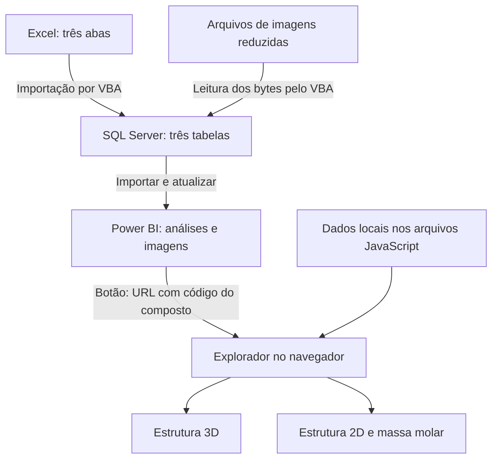
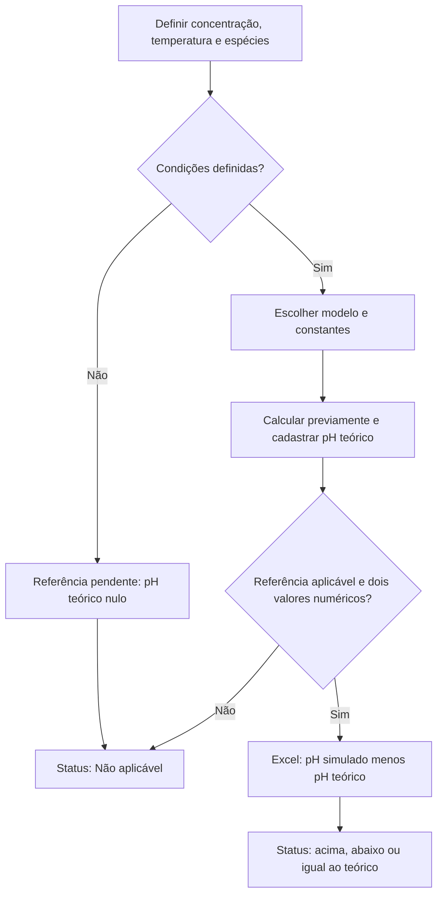

# Análise de Soluções Químicas Integradas e Explorador Molecular
 -- 

**Versão de referência: v0.1.0-beta — projeto em desenvolvimento.**

Este é um projeto que criei para conectar quatro coisas que eu queria aprender ao mesmo tempo: modelagem de dados relacionais, automação com VBA, análise em Power BI e front-end interativo com renderização 3D. Em vez de fazer quatro exercícios separados, decidi fazer um projeto só onde o mesmo dado atravessa as quatro ferramentas — um cadastro de compostos químicos e análises simuladas que nasce no Excel, passa pelo SQL Server, vira relatório no Power BI e termina como um explorador molecular interativo no navegador.

**Os dados de pH medido são simulados, para fins de estudo — não são medições de laboratório.** Os modelos moleculares são didáticos, e a revisão química completa ainda está em andamento.

---

## Por que fiz o projeto assim

Eu podia ter escolhido uma ferramenta só e um problema fechado. Preferi o contrário: pegar um mesmo conjunto de dados — 17 compostos, suas referências de pH e as análises simuladas — e fazer ele passar por quatro ferramentas diferentes, cada uma responsável por uma etapa:

1. **Excel** é onde cadastro e edito os dados — é a interface mais simples que eu tinha à mão.
2. **SQL Server** é onde o dado ganha integridade de verdade — chaves, relacionamentos, tipos.
3. **Power BI** é onde o dado vira informação — filtros, comparações, apresentação visual.
4. **O explorador web** é onde o dado ganha uma representação que nenhuma das outras ferramentas me dava de graça — um modelo 3D manipulável, no navegador.

A maior parte do que aprendi não foi em nenhuma ferramenta isolada — foi nas costuras entre elas. Foi aí que apareceram os problemas mais interessantes de resolver.

---

## Visão geral da arquitetura



O Excel organiza os dados de entrada. O VBA envia esses dados e os arquivos de imagem para o SQL Server. O Power BI importa as tabelas do banco e apresenta os resultados.

O explorador é uma aplicação web **separada**. O botão do relatório envia o código do composto na URL, por exemplo `?composto=H2SO4`, e o JavaScript interpreta esse código para selecionar a estrutura certa.

**Uma decisão de arquitetura que assumo aqui de propósito:** essa ligação é só de navegação, não de dados. A URL diz *qual* composto abrir, mas não carrega nenhum valor do banco junto. Os modelos 3D, os desenhos 2D e as massas molares do explorador estão cadastrados localmente dentro de `script.js` e `complemento.js` — copiei esses valores manualmente a partir do Excel. Se eu mudar um valor direto no SQL Server (ou no Excel, seguido de uma nova execução da macro), o Power BI incorpora as alterações quando executo a atualização do relatório — quem ele lê é o banco, não o Excel em si. Mas o site continua fora desse ciclo: só muda se eu editar o JavaScript à mão. Escolhi isso nesta fase para não precisar expor o banco de dados publicamente atrás de um site estático — não foi um descuido, foi a troca que fez sentido para uma beta.

| Componente | Tecnologia | Função | Onde mora o dado |
| --- | --- | --- | --- |
| Entrada de dados | Excel e VBA | Cadastro e importação | Arquivo `.xlsm` (fora deste repositório) |
| Banco | SQL Server Express | Persistência e relacionamentos | Instância SQL local |
| Relatório | Power BI Desktop e Power Query | Filtros, tabelas e imagens | Arquivo `.pbix` (fora deste repositório) |
| Explorador | HTML, CSS e JavaScript | Interface e seleção de composto | Cópia local nos arquivos `.js` deste repositório |
| Estruturas 3D | 3Dmol.js | Renderização dos modelos | Coordenadas em formato SDF, dentro de `script.js` |
| Estruturas 2D | SVG e JavaScript | Desenhos com átomos selecionáveis | Dentro de `complemento.js` |

---

## Organização dos dados

| Aba do Excel | Tabela SQL | Chave principal |
| --- | --- | --- |
| Compostos | `excel.Compostos` | `IDComposto` |
| ReferênciaPH | `excel.ReferenciaPH` | `IDReferencia` |
| Analises | `excel.Analises` | `IDAnalise` |

`excel` é o esquema das tabelas atuais dentro do banco `Laboratório`. Existe uma tabela antiga, `dbo.Analises`, de uma etapa anterior do desenvolvimento, que não uso mais neste modelo.

**Relacionamentos:**
- As referências pertencem aos compostos (`ReferenciaPH.IDComposto` → `Compostos.IDComposto`).
- As análises apontam para uma referência e para seu composto, através de uma **chave estrangeira composta**: `(IDReferencia, IDComposto)` em `Analises` referencia `(IDReferencia, IDComposto)` em `ReferenciaPH`. Isso garante, no nível do banco, que a referência usada por uma análise realmente pertence ao mesmo composto — se eu errar isso na importação, o banco rejeita, em vez de eu descobrir o erro depois numa consulta.

No Power BI, o caminho de filtros que configurei é:

1. `Compostos[IDComposto]` (lado 1) → `ReferenciaPH[IDComposto]` (lado muitos).
2. `ReferenciaPH[IDReferencia]` (lado 1) → `Analises[IDReferencia]` (lado muitos).

Os dois relacionamentos são ativos e com filtro em direção única — filtrar por um composto restringe suas referências e análises, mas não o contrário.

---

## A macro VBA de importação (`vba/modImportacaoSQL.bas`)

Essa foi a parte mais trabalhosa de fazer funcionar direito, e é a peça que mais me orgulho tecnicamente no projeto. A rotina principal, `ImportarLaboratorioSQL`, faz o seguinte, nesta ordem:

1. **Valido os IDs antes de escrever qualquer coisa.** A sub-rotina `ValidarIDs` percorre cada aba e garante que não existem IDs duplicados nem células com erro de fórmula, nas três abas. Se algo estiver errado, a macro para antes de tocar no banco.
2. **Carrego as imagens em memória antes de abrir a conexão.** A função `LocalizarImagem` tenta várias combinações de nome e extensão (`.jpg`, `.jpeg`, `.png`) e, se não encontrar automaticamente, abre uma caixa de diálogo para eu escolher o arquivo na mão — preferi isso a deixar o processo travar silenciosamente por um nome de arquivo divergente.
3. **Abro a conexão dentro de uma transação.** Uso `ADODB.Connection` com `Provider=SQLOLEDB`, autenticação do Windows, `SET XACT_ABORT ON` e isolamento `SERIALIZABLE`. A importação inteira roda dentro de `BeginTrans`/`CommitTrans`: se qualquer linha falhar, o bloco `Falha:` chama `RollbackTrans`, e nada fica salvo pela metade.
4. **Crio o esquema só se ele ainda não existir.** `PrepararTabelas` roda `CREATE SCHEMA excel` e os três `CREATE TABLE`, cada um dentro de `IF OBJECT_ID(...) IS NULL` — assim posso rodar a macro de novo num banco que já tem as tabelas sem recriar nem apagar nada.
5. **Faço upsert linha a linha.** `GravarRegistro` primeiro checa se o ID já existe; se sim, monta um `UPDATE`, senão um `INSERT`. Todos os valores vão como parâmetros ADO tipados, não concatenados na string — evita injeção de SQL e problema de escaping com acentos e aspas.
6. **Trato os dois casos pendentes de propósito, não por acidente.** A função `NumeroSQL` é onde resolvo Ca(OH)₂ e H₂CO₃: se a célula não é número, verifico se o texto é exatamente "condição precisa ser revista" ou "condição precisa ser definida" — só nesses dois casos grava `NULL` no banco. Qualquer outro texto inesperado interrompe a importação com uma mensagem específica, em vez de gravar algo errado sem eu perceber.
7. **No fim, mostro um resumo.** Uma caixa de mensagem com o total gravado em cada tabela, pra eu conferir rápido contra o número esperado (17 em cada).

A macro foi desenvolvida com apoio de IA para validar os dados antes da gravação, usar transação com rollback e tratar os casos pendentes de forma explícita.

---

## O explorador web

Quatro arquivos formam a aplicação: `index.html`, `style.css` (tema escuro) e dois arquivos de lógica, `script.js` (modelos 3D e navegação) e `complemento.js` (massas molares e desenhos 2D). Eles precisam ficar juntos na mesma pasta — não usei nenhum empacotador, é tudo referenciado por IDs de DOM fixos.

### Como o composto chega pela URL

Ao carregar, `script.js` lê o parâmetro `composto` da URL com `URLSearchParams(window.location.search)`. É assim que o botão do Power BI ("Explorar em 3D") abre o site já com a molécula certa selecionada — o link montado no relatório é só `index.html?composto=H2SO4`.

### Modelos 3D

Cada composto é uma entrada num objeto JavaScript (`compostos`, em `script.js`) com nome, fórmula, descrição e uma **estrutura em formato SDF** — um formato-texto de química computacional com coordenadas atômicas e ligações. Essa string vai direto para a biblioteca **3Dmol.js**, que desenha a cena com WebGL, incluindo rotação, zoom e clique nos átomos pra identificação.

São coordenadas aproximadas para fins didáticos — não rodei nenhuma otimização de geometria molecular real nelas, e deixo isso claro no comentário do código.

### Desenhos 2D e massas molares

`complemento.js` desenha as estruturas 2D em SVG puro, sem biblioteca externa, e mostra a massa molar de cada composto. A navegação por teclado (Tab entre átomos, Enter/Espaço para selecionar) foi implementada com apoio de IA, usando atributos de acessibilidade no SVG. A conferência completa dessa interação ainda faz parte da revisão da beta.

### Movimento reduzido

`script.js` escuta a preferência `prefers-reduced-motion` do sistema e ajusta a rotação automática do modelo 3D. Um detalhe pequeno, mas que fiz questão de incluir.

---

## Botão "Explorar em 3D" no Power BI

O relatório usa uma medida DAX, `LinkExplorador`, que combina o endereço do site com o código do composto selecionado, e um botão com ação **URL da Web** apontando pra essa medida.

Pontos que aprendi na marra:

- Sem uma seleção única de composto, a medida retorna vazio — o botão não abre nada.
- Nem todo código é a fórmula óbvia: hidróxido de cálcio é `CaOH2` (sem parênteses nem subscrito), ácido hipocloroso é `HClO`. A medida mapeia isso pelos IDs.
- Testo localmente com **Ctrl + clique** no Power BI Desktop.
- O endereço usado em desenvolvimento (`http://127.0.0.1:5500`) só funciona na minha máquina rodando o Live Server. Hospedar publicamente exigiria atualizar essa medida — ainda não faz parte desta beta.

---

## Hipóteses e cálculos dos valores de pH

Conferi os valores teóricos para concentração de **0,100 mol/L**, temperatura de **25 °C**, com uma aproximação didática que usa concentrações no lugar de atividades químicas.

| Composto ou grupo | pH teórico | Método / constante adotada |
| --- | ---: | --- |
| HCl, HNO₃, HBr, HI e HClO₄ | 1,00 | Ácidos fortes monopróticos: −log(C) |
| H₂SO₄ | 0,96 | Primeira dissociação completa e equilíbrio da segunda; Ka₂ = 1,2 × 10⁻² |
| NaOH | 13,00 | Base forte: 14 + log(C) |
| NH₃ | 11,12 | Equilíbrio com Kb = 1,8 × 10⁻⁵ |
| "NH₄OH" / amônia aquosa | 11,12 | Mesmo equilíbrio da amônia; C representa amônia analítica total |
| NaCl e KCl | 7,00 | Sais sem hidrólise relevante no modelo ideal |
| NH₄Cl | 5,13 | Hidrólise de NH₄⁺; Ka = Kw/Kb da amônia, com Kw = 10⁻¹⁴ |
| HF | 2,11 | Equilíbrio com Ka = 6,4 × 10⁻⁴ |
| H₃BO₃ | 5,13 | Equilíbrio com Ka = 5,4 × 10⁻¹⁰ |
| HClO | 4,27 | Equilíbrio com Ka = 2,9 × 10⁻⁸ |
| Ca(OH)₂ | Deixei pendente | Depende da concentração efetivamente dissolvida (solubilidade) |
| H₂CO₃ | Deixei pendente | Depende de quais espécies de carbono dissolvido considerar |

Os dois casos "pendentes" não são erro de cálculo — são situações em que a hipótese necessária ainda não está fechada pra mim, e preferi não inventar um número sem essa definição. No banco, esses dois casos chegam como `NULL` (é o que a função `NumeroSQL` da macro faz de propósito), e o relatório do Power BI já deixa claro que os valores de pH são simulados — o que cobre esses dois casos também.

Constantes consultadas nos [apêndices H](https://openstax.org/books/chemistry-2e/pages/h-ionization-constants-of-weak-acids) e [I](https://openstax.org/books/chemistry-2e/pages/i-ionization-constants-of-weak-bases) de *Chemistry 2e* (OpenStax), fundamentadas nas seções [14.2](https://openstax.org/books/chemistry-2e/pages/14-2-ph-and-poh), [14.3](https://openstax.org/books/chemistry-2e/pages/14-3-relative-strengths-of-acids-and-bases) e [14.4](https://openstax.org/books/chemistry-2e/pages/14-4-hydrolysis-of-salts).

### Como os cálculos entram no projeto

Os valores de pH teórico foram calculados previamente, com apoio de IA, e cadastrados na aba `ReferênciaPH` do Excel. As equações abaixo documentam a origem desses valores; o explorador não executa esses cálculos. O Excel busca a referência cadastrada e calcula a diferença em relação ao pH simulado quando os dois valores são numéricos e a referência é aplicável.

O diagrama representa o processo de definição e uso da referência, não uma rotina que escolhe automaticamente o modelo químico:



### Notação

- `C`: concentração analítica inicial, mol/L.
- `x`: concentração que reage na etapa considerada, mol/L.
- `S`: solubilidade molar, quando aplicável.
- `Ka`, `Kb`: constantes de equilíbrio ácido e básico.
- `Kw`: produto iônico da água, 10⁻¹⁴ a 25 °C.

### Ácidos fortes monopróticos (HCl, HNO₃, HBr, HI, HClO₄)

$$
[\mathrm{H_3O^+}]\approx C \quad\Longrightarrow\quad \mathrm{pH}\approx-\log_{10}(C)
$$

Para C = 0,100 mol/L, pH = 1,00.

### Base forte (NaOH)

$$
[\mathrm{OH^-}]\approx C \quad\Longrightarrow\quad \mathrm{pH}\approx14+\log_{10}(C)
$$

Para C = 0,100 mol/L, pH = 13,00.

### Ácidos fracos — equilíbrio com Ka (HF, HClO, H₃BO₃)

$$
K_a=\frac{x^2}{C-x} \quad\Longrightarrow\quad x=\frac{-K_a+\sqrt{K_a^2+4K_aC}}{2} \quad\Longrightarrow\quad \mathrm{pH}\approx-\log_{10}(x)
$$

Os valores foram obtidos pela raiz da equação quadrática, com apoio de IA na elaboração e conferência dos cálculos, sem usar a aproximação simplificada `x = √(KaC)`.

| Exemplo | C (mol/L) | Ka | x (mol/L) | pH |
| --- | ---: | ---: | ---: | ---: |
| HF | 0,100 | 6,4 × 10⁻⁴ | 7,6864 × 10⁻³ | 2,11 |
| HClO | 0,100 | 2,9 × 10⁻⁸ | 5,3837 × 10⁻⁵ | 4,27 |
| H₃BO₃ | 0,100 | 5,4 × 10⁻¹⁰ | — | 5,13 |

### Amônia — equilíbrio com Kb

$$
K_b=\frac{x^2}{C-x} \quad\Longrightarrow\quad \mathrm{pH}\approx14+\log_{10}(x)
$$

Para C = 0,100 mol/L e Kb = 1,8 × 10⁻⁵, x ≈ 1,3327 × 10⁻³ mol/L, pH ≈ 11,12.

### Cloreto de amônio — hidrólise do NH₄⁺

$$
K_a(\mathrm{NH_4^+})=\frac{K_w}{K_b(\mathrm{NH_3})}\approx5{,}56\times10^{-10}
$$

Resolvido com a mesma equação quadrática dos ácidos fracos: pH ≈ 5,13.

### Ácido sulfúrico — segunda dissociação

Depois da primeira dissociação completa, o modelo considera C mol/L de H₃O⁺ e de HSO₄⁻. Na segunda etapa:

$$
\mathrm{HSO_4^-+H_2O\rightleftharpoons H_3O^++SO_4^{2-}}
$$

Se x mol/L de HSO₄⁻ se dissocia nessa etapa:

$$
K_{a2}=\frac{(C+x)x}{C-x}
$$

Reorganizando e usando a raiz positiva:

$$
x^2+(C+K_{a2})x-K_{a2}C=0
$$

$$
x=\frac{-(C+K_{a2})+\sqrt{(C+K_{a2})^2+4K_{a2}C}}{2}
$$

$$
\mathrm{pH}\approx-\log_{10}(C+x)
$$

Para C = 0,100 mol/L e Ka₂ = 1,2 × 10⁻², x ≈ 0,00985 mol/L e pH ≈ 0,96. O cálculo não pressupõe liberação completa dos dois prótons.

### Diferença de pH e classificação no Excel

$$
\Delta\mathrm{pH}=\mathrm{pH}_{\mathrm{simulado}}-\mathrm{pH}_{\mathrm{teorico}}
$$

Calculada na coluna `L` do Excel (`=I3-K3`), classificada como "Acima do teórico", "Abaixo do teórico", "Igual ao teórico" ou "Não aplicável". Não é uma avaliação de incerteza experimental — é só a comparação direta entre os dois números cadastrados.

### Massa molar

$$
M=\sum_i n_iM_i
$$

As massas molares foram cadastradas com apoio de IA (ex.: H₂SO₄ = 98,08 g/mol, Ca(OH)₂ = 74,09 g/mol) e comparadas entre o Excel e o explorador. O explorador exibe o valor já calculado; não recalcula a partir da fórmula desenhada.

---

## O que os modelos assumem

- Os modelos 3D usam coordenadas aproximadas, sem validação de geometria ou otimização molecular.
- Os desenhos 2D mostram conectividade e cargas formais cadastradas, sem pares de elétrons não ligantes.
- Compostos iônicos são representados como íons na proporção da fórmula, sem reproduzir a rede cristalina real.
- Para "hidróxido de amônio", mostro NH₃ e H₂O (o lado esquerdo do equilíbrio NH₃ + H₂O ⇌ NH₄⁺ + OH⁻), não uma molécula isolada de NH₄OH — o valor de 35,05 g/mol é da fórmula nominal, não da solução como um todo.
- A carga formal exibida é do átomo selecionado, não é carga parcial real.

Referência conceitual: [OpenStax, seção 7.4 — Formal Charges and Resonance](https://openstax.org/books/chemistry-2e/pages/7-4-formal-charges-and-resonance).

---

## Como rodar o explorador localmente

Dá pra abrir sem precisar do Excel, do SQL Server ou do Power BI — é uma aplicação estática.

1. Abra a pasta do projeto no VS Code.
2. Com a extensão **Live Server**, de Ritwick Dey, instalada, abra `index.html` usando **Open with Live Server**.
3. Acesse o endereço informado pelo servidor (usei `http://127.0.0.1:5500/index.html` — a porta pode variar).
4. Selecione um composto para ver o modelo 3D, as informações e o desenho 2D.
5. Clique nos átomos pra identificar, ou navegue com Tab e selecione com Enter/Espaço.

A biblioteca 3Dmol.js carrega da internet pelo HTML — precisa de conexão e de um navegador com WebGL. A ordem dos scripts no fim do HTML precisa ser exatamente esta:

```html
<script src="https://3Dmol.org/build/3Dmol-min.js"></script>
<script src="script.js"></script>
<script src="complemento.js"></script>
```

Pra testar a seleção direta por endereço, acrescente `?composto=H2SO4` à URL.

## Como rodar o fluxo completo (Excel, SQL Server, Power BI)

Precisa dos arquivos que não estão neste repositório: a planilha com a macro (`.xlsm`), as imagens reduzidas, e o relatório (`.pbix`). Também precisa de Excel para desktop no Windows, acesso a uma instância SQL Server, e os componentes ADO que a macro usa.

Ambiente que usei no desenvolvimento (ajuste pro seu):

| Configuração | Valor usado |
| --- | --- |
| Instância SQL Server | `localhost\SQLEXPRESS` |
| Banco configurado na macro | `Laboratório` |
| Autenticação | Windows |
| Modo no Power BI | Importar |
| Pasta das imagens | `C:\Users\kelvin\OneDrive\Imagens\Soluções_Reduzidas\` |

Esses caminhos são do meu ambiente e precisam ser ajustados em outra máquina. O banco `Laboratório` precisa existir antes de rodar a macro — ela cria o esquema e as tabelas dentro dele, não o banco em si.

1. Confiro as três abas, os IDs e os caminhos das imagens na macro.
2. Executo `ImportarLaboratorioSQL` no Excel — a ordem de envio é compostos, referências e análises, numa única transação.
3. Confiro o resultado no SQL Server — a base inicial tem 17 registros em cada tabela.
4. No Power BI, importo as tabelas do esquema `excel` e confiro os relacionamentos.
5. Na consulta de compostos, converto a coluna `Estrutura` para uma URI Base64 (`ImagemURL`) e removo a coluna binária depois da conversão.
6. Uso a segmentação de compostos pra filtrar imagens e análises.

O VBA lê as imagens dos arquivos da pasta configurada — não extrai bytes de figuras desenhadas dentro da planilha. Mudar só a imagem visível no Excel não troca automaticamente o arquivo que a macro vai enviar.

O ciclo de atualização normal é: edito e salvo o Excel → rodo a macro → atualizo o Power BI. Mas o Power BI não sabe se o dado veio da macro ou de uma edição direta no SQL Server — ele só lê o banco no momento da atualização. Então também dá pra alterar um valor direto no SQL Server e só atualizar o Power BI depois, sem passar pelo Excel. O que não muda é o modo Importar em si, que não acompanha o banco em tempo real, e o site, que não consulta o banco — mudanças em massa molar preciso refletir manualmente em `complemento.js` nesta fase.

---

## O que já verifiquei, e o que ainda falta

O que já checei:

- Importação de 17 registros em cada uma das três tabelas, sem imagens nulas ou com zero bytes.
- Filtro por composto testado no Power BI, e a abertura do explorador pelo botão.
- Massa molar e desenho 2D exibidos corretamente no navegador para os compostos testados.
- Revisão manual dos casos de HNO₃, NH₄Cl e amônia aquosa.
- Recálculo dos valores de pH sob as hipóteses documentadas acima.

O que ainda está pendente, por decisão minha e não por esquecimento:

- Ca(OH)₂ e H₂CO₃ não têm pH teórico numérico, pela razão que expliquei na seção de cálculos.
- Revisão química completa das 17 estruturas ainda não terminou.
- Não tenho testes automatizados ainda.
- Ainda não testei em telas diferentes nem em outra máquina, fora dos caminhos fixos do meu ambiente.

Essas verificações não são uma validação química completa dos 17 compostos — este é, declaradamente, um projeto de prática de integração de dados, não um laudo técnico.

---

## Sobre mim e o uso de IA neste projeto

Sou Kelvin Gonçalves, e fiz este projeto pra praticar a integração entre química e dados.

Usei o ChatGPT como apoio na geração e explicação de código, na elaboração de imagens, na identificação de erros e na revisão — principalmente para gerar HTML, CSS, JavaScript e VBA. O objetivo, a organização do ambiente e dos dados, a execução da integração e os testes e ajustes foram meus.

Este projeto registra um processo de aprendizado — usar essas tecnologias nesta beta não significa que já domino todas elas a fundo. Imagens geradas com IA exigem revisão química, e já precisei corrigir algumas durante o desenvolvimento.

---

## Referências

**Química (fundamentação dos cálculos):**
- Flowers, Paul; Theopold, Klaus; Langley, Richard; Robinson, William R. *Chemistry 2e*. OpenStax, Rice University, 2019. [Acesso ao livro](https://openstax.org/books/chemistry-2e/pages/1-introduction).
- SANTOS, Hélio F. dos. [O Conceito da Modelagem Molecular](https://qnesc.sbq.org.br/online/cadernos/04/modelag.pdf). *Cadernos Temáticos de Química Nova na Escola*, n. 4, maio de 2001.
- DUARTE, Hélio A. [Ligações Químicas: Ligação Iônica, Covalente e Metálica](https://qnesc.sbq.org.br/online/cadernos/04/ligacoes.pdf). *Cadernos Temáticos de Química Nova na Escola*, n. 4, maio de 2001.

**Técnicas:**
- [3Dmol.js — documentação](https://3dmol.org/doc/)
- [Microsoft — conector SQL Server no Power Query](https://learn.microsoft.com/en-us/power-query/connectors/sql-server)
- [Microsoft — Binary.ToText](https://learn.microsoft.com/en-us/powerquery-m/binary-totext)
- [Microsoft — relacionamentos no Power BI](https://learn.microsoft.com/en-us/power-bi/transform-model/desktop-relationships-understand)
- [Microsoft — botões e ações no Power BI](https://learn.microsoft.com/en-us/power-bi/create-reports/desktop-buttons)
- [Microsoft — SELECTEDVALUE](https://learn.microsoft.com/en-us/dax/selectedvalue-function-dax)

Os diagramas estão em blocos `mermaid` e as equações em LaTeX delimitado por `$$` — o GitHub renderiza os dois nativamente em Markdown.

## Próxima revisão

Meu próximo passo é revisar esta beta: terminar a conferência química, padronizar as referências das massas molares, e reunir os arquivos e scripts necessários pra reproduzir o fluxo completo. Publicar o repositório e hospedar o site são etapas de depois.
