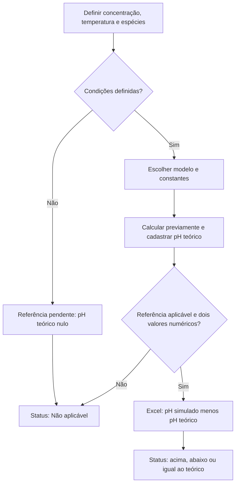

# Hipóteses químicas preservadas

O texto abaixo preserva as explicações científicas do README original do autor. A revisão técnica não realizou nova validação experimental nem revisão química independente. Procedimentos de execução e autoridades de dados atuais estão em SETUP.md e ARCHITECTURE.md.

## Hipóteses e cálculos dos valores de pH

Conferi os valores teóricos para concentração de **0,100 mol/L**, temperatura de **25 °C**, com uma aproximação didática que usa concentrações no lugar de atividades químicas.

| Composto ou grupo | pH teórico | Método / constante adotada |
| --- | ---: | --- |
| HCl, HNO₃, HBr, HI e HClO₄ | 1,00 | Ácidos fortes monopróticos: −log(C) |
| H₂SO₄ | 0,96 | Primeira dissociação completa e equilíbrio da segunda; Ka₂ = 1,2 × 10⁻² |
| NaOH | 13,00 | Base forte: 14 + log(C) |
| NH₃ | 11,12 | Equilíbrio com Kb = 1,8 × 10⁻⁵ |
| "NH₄OH" / amônia aquosa | 11,12 | Mesmo equilíbrio da amônia; C representa amônia analítica total |
| NaCl e KCl | 7,00 | Sais sem hidrólise relevante no modelo ideal |
| NH₄Cl | 5,13 | Hidrólise de NH₄⁺; Ka = Kw/Kb da amônia, com Kw = 10⁻¹⁴ |
| HF | 2,11 | Equilíbrio com Ka = 6,4 × 10⁻⁴ |
| H₃BO₃ | 5,13 | Equilíbrio com Ka = 5,4 × 10⁻¹⁰ |
| HClO | 4,27 | Equilíbrio com Ka = 2,9 × 10⁻⁸ |
| Ca(OH)₂ | Deixei pendente | Depende da concentração efetivamente dissolvida (solubilidade) |
| H₂CO₃ | Deixei pendente | Depende de quais espécies de carbono dissolvido considerar |

Os dois casos "pendentes" não são erro de cálculo — são situações em que a hipótese necessária ainda não está fechada pra mim, e preferi não inventar um número sem essa definição. No banco, esses dois casos chegam como `NULL` (é o que a função `NumeroSQL` da macro faz de propósito), e o relatório do Power BI já deixa claro que os valores de pH são simulados — o que cobre esses dois casos também.

Constantes consultadas nos [apêndices H](https://openstax.org/books/chemistry-2e/pages/h-ionization-constants-of-weak-acids) e [I](https://openstax.org/books/chemistry-2e/pages/i-ionization-constants-of-weak-bases) de *Chemistry 2e* (OpenStax), fundamentadas nas seções [14.2](https://openstax.org/books/chemistry-2e/pages/14-2-ph-and-poh), [14.3](https://openstax.org/books/chemistry-2e/pages/14-3-relative-strengths-of-acids-and-bases) e [14.4](https://openstax.org/books/chemistry-2e/pages/14-4-hydrolysis-of-salts).

### Como os cálculos entram no projeto

Os valores de pH teórico foram calculados previamente, com apoio de IA, e cadastrados na aba `ReferênciaPH` do Excel. As equações abaixo documentam a origem desses valores; o explorador não executa esses cálculos. O Excel busca a referência cadastrada e calcula a diferença em relação ao pH simulado quando os dois valores são numéricos e a referência é aplicável.

O diagrama representa o processo de definição e uso da referência, não uma rotina que escolhe automaticamente o modelo químico:

### Notação

- `C`: concentração analítica inicial, mol/L.
- `x`: concentração que reage na etapa considerada, mol/L.
- `S`: solubilidade molar, quando aplicável.
- `Ka`, `Kb`: constantes de equilíbrio ácido e básico.
- `Kw`: produto iônico da água, 10⁻¹⁴ a 25 °C.

### Ácidos fortes monopróticos (HCl, HNO₃, HBr, HI, HClO₄)

$$
[\mathrm{H_3O^+}]\approx C \quad\Longrightarrow\quad \mathrm{pH}\approx-\log_{10}(C)
$$

Para C = 0,100 mol/L, pH = 1,00.

### Base forte (NaOH)

$$
[\mathrm{OH^-}]\approx C \quad\Longrightarrow\quad \mathrm{pH}\approx14+\log_{10}(C)
$$

Para C = 0,100 mol/L, pH = 13,00.

### Ácidos fracos — equilíbrio com Ka (HF, HClO, H₃BO₃)

$$
K_a=\frac{x^2}{C-x} \quad\Longrightarrow\quad x=\frac{-K_a+\sqrt{K_a^2+4K_aC}}{2} \quad\Longrightarrow\quad \mathrm{pH}\approx-\log_{10}(x)
$$

Os valores foram obtidos pela raiz da equação quadrática, com apoio de IA na elaboração e conferência dos cálculos, sem usar a aproximação simplificada `x = √(KaC)`.

| Exemplo | C (mol/L) | Ka | x (mol/L) | pH |
| --- | ---: | ---: | ---: | ---: |
| HF | 0,100 | 6,4 × 10⁻⁴ | 7,6864 × 10⁻³ | 2,11 |
| HClO | 0,100 | 2,9 × 10⁻⁸ | 5,3837 × 10⁻⁵ | 4,27 |
| H₃BO₃ | 0,100 | 5,4 × 10⁻¹⁰ | — | 5,13 |

### Amônia — equilíbrio com Kb

$$
K_b=\frac{x^2}{C-x} \quad\Longrightarrow\quad \mathrm{pH}\approx14+\log_{10}(x)
$$

Para C = 0,100 mol/L e Kb = 1,8 × 10⁻⁵, x ≈ 1,3327 × 10⁻³ mol/L, pH ≈ 11,12.

### Cloreto de amônio — hidrólise do NH₄⁺

$$
K_a(\mathrm{NH_4^+})=\frac{K_w}{K_b(\mathrm{NH_3})}\approx5{,}56\times10^{-10}
$$

Resolvido com a mesma equação quadrática dos ácidos fracos: pH ≈ 5,13.

### Ácido sulfúrico — segunda dissociação

Depois da primeira dissociação completa, o modelo considera C mol/L de H₃O⁺ e de HSO₄⁻. Na segunda etapa:

$$
\mathrm{HSO_4^-+H_2O\rightleftharpoons H_3O^++SO_4^{2-}}
$$

Se x mol/L de HSO₄⁻ se dissocia nessa etapa:

$$
K_{a2}=\frac{(C+x)x}{C-x}
$$

Reorganizando e usando a raiz positiva:

$$
x^2+(C+K_{a2})x-K_{a2}C=0
$$

$$
x=\frac{-(C+K_{a2})+\sqrt{(C+K_{a2})^2+4K_{a2}C}}{2}
$$

$$
\mathrm{pH}\approx-\log_{10}(C+x)
$$

Para C = 0,100 mol/L e Ka₂ = 1,2 × 10⁻², x ≈ 0,00985 mol/L e pH ≈ 0,96. O cálculo não pressupõe liberação completa dos dois prótons.

### Diferença de pH e classificação no Excel

$$
\Delta\mathrm{pH}=\mathrm{pH}_{\mathrm{simulado}}-\mathrm{pH}_{\mathrm{teorico}}
$$

Calculada na coluna `L` do Excel (`=I3-K3`), classificada como "Acima do teórico", "Abaixo do teórico", "Igual ao teórico" ou "Não aplicável". Não é uma avaliação de incerteza experimental — é só a comparação direta entre os dois números cadastrados.

### Massa molar

$$
M=\sum_i n_iM_i
$$

As massas molares foram cadastradas com apoio de IA (ex.: H₂SO₄ = 98,08 g/mol, Ca(OH)₂ = 74,09 g/mol) e comparadas entre o Excel e o explorador. O explorador exibe o valor já calculado; não recalcula a partir da fórmula desenhada.

---

## O que os modelos assumem

- Os modelos 3D usam coordenadas aproximadas, sem validação de geometria ou otimização molecular.
- Os desenhos 2D mostram conectividade e cargas formais cadastradas, sem pares de elétrons não ligantes.
- Compostos iônicos são representados como íons na proporção da fórmula, sem reproduzir a rede cristalina real.
- Para "hidróxido de amônio", mostro NH₃ e H₂O (o lado esquerdo do equilíbrio NH₃ + H₂O ⇌ NH₄⁺ + OH⁻), não uma molécula isolada de NH₄OH — o valor de 35,05 g/mol é da fórmula nominal, não da solução como um todo.
- A carga formal exibida é do átomo selecionado, não é carga parcial real.

Referência conceitual: [OpenStax, seção 7.4 — Formal Charges and Resonance](https://openstax.org/books/chemistry-2e/pages/7-4-formal-charges-and-resonance).

---

